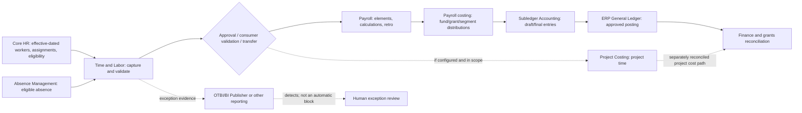

# CPUS — original first-pass Oracle HCM + ERP advisory response

**Recorded:** 2026-10-31 (America/Chicago)  
**Artifact state:** FROZEN FIRST RESPONSE / in-session demonstration, NOT independent blind acceptance  
**Client:** Cascadia Public University System (fictional)  
**Evidence legend:** [D] actual Project design source, [V] official external documentation verified during this session, [I] illustrative architecture or proposed operating control, [U] customer/release/tenant detail not verified. The bracketed labels govern each named claim; a citation never proves the fictional customer owns or configured a product.

## Executive recommendation

Implement a controlled **time-to-pay-to-cost-to-account** workflow with policy-specific time validations and approval, explicit retro-processing, a documented grant/fund costing model, subledger-to-ledger reconciliation and segregation of duties. Prioritize **deterministic validations, exception routing and reconciled accounting** before considering an AI anomaly assistant. The desired business outcomes are reasonable architecture goals, but CPUS cannot mark the entire scope *Fully Supported / Native*, assert universal grant interfund postings, transfer U.S. payroll rules to Ontario, or commit to 90 days. **No payroll, overtime, or posting amount can be established from the supplied fictional facts.** [D: Operating Standard §§3–6; U: customer environment]

**Outcome versus proposed mechanism:** The outcomes are accurate time and pay, grant-charge accuracy, controlled close and traceable correction. An OTBI report can be designed to identify exceptions, but **reporting itself is not a blocking transaction control**. Any prevention must be proved through actual Time and Labor validation, approval and transfer behavior and related controls. Oracle documents time-entry rule validation, calculation, consumer validation and transfer as separate stages. [V: O01, O02; I: control design]

## Facts, policies and essential unknowns

- **Synthetic case facts:** Oregon and Washington campuses under a U.S. biweekly payroll; a separately governed Ontario research affiliate; a worker with two concurrent assignments, different rates, multiple grants, an unpaid meal, absence, premium claims, a correction after approval and an effective-dated rate/assignment update after calculation. These facts are scenario inputs, not customer observations. [I]
- **Verified general Oracle capabilities:** Oracle's Time and Labor documentation describes time validation/calculation and time consumers including Global Payroll and Project Costing; Oracle's Payroll documentation describes retroactive recalculation and costing/accounting stages. No inference about CPUS tenant readiness follows. [V: O01–O05]
- **Verified public legal guidance, not a CPUS determination:** The U.S. Department of Labor describes a repeated hour on fall daylight-saving changeover that must be counted if actually worked; Oregon and Washington publish jurisdiction-specific overtime guidance. Canada has distinct T4 and ROE employer reporting regimes. These are not a substitute for public-employer legal analysis or collective agreements. [V: G01–G05]
- **Unverified:** Actual Fusion quarterly release, licensed modules/options, access/privileges, employer/LDG/payroll relationship structure, payroll and absence eligibility, union provisions, overtime method, compensable meal period, start/end offset records, public-sector exemptions, grant restrictions, project mapping, chart of accounts, SLA and GL setup, closed-period handling, integration inventory, data security and AI capability. [U]

## Functional architecture and ownership

*All arrows are a candidate logical design, not tested CPUS interfaces or a guarantee of double-entry handling. Owners and routing depend on the target architecture.* [I]

1. **Core HR (employment/assignment owner):** Validate the worker's employer, multiple work assignments, assignment rates/effective dates, time-processing groups, payroll relationship(s) and element eligibility. Cross-assignment aggregation or separate relationships must follow confirmed organizational/legal structure. Segregate faculty/adjunct, graduate assistant, hourly and bargaining groups by documented eligible policy—not title alone. [I/U]
2. **Time and Labor (entry/calculation owner):** Capture clock instants with timezone and UTC offset or other validated unambiguous time event evidence, campus/assignment, work date, meal, premiums and project distribution. Preserve both occurrences of ambiguous 1 a.m. local time on DST fallback when actually worked; test whether source devices/Time and Labor transmit disambiguating data. Evaluate time entry rules, calculation rules, consumer-validation and exception routing. The repeat hour is not automatically overtime without confirmed workweek and rules. [V: O01, G01; I/U]
3. **Approvals:** Define who approves each assignment and project-related entries; whether pay and project consumers require distinct approvers; what changes require resubmission after approval; and the process to handle rejected/incomplete transfers. Oracle documents payroll/project approval configurations, but CPUS status behavior is unproven. [V: O06; I/U]
4. **Absence:** Validate eligibility, effective dates, submitted hours and overlap with work/holiday; agree whether an absence is paid and which downstream time/element path applies. Do not assume paid absence counts toward statutory overtime. [I/U]
5. **Payroll (pay and retro owner):** Map approved calculated time to appropriate elements/rates, calculate by confirmed payroll relationships and legal/contractual rules, review payroll results and exception reports; explicitly evaluate how after-approval corrections, backdated rates and premium eligibility create or fail to create retro events. Oracle's U.S. documentation says relevant retro event group/element configuration matters, and retroprocessing creates adjustments without overwriting historical results. [V: O04; I/U]
6. **Costing (payroll costing owner):** Agree earning-to-cost distributions, time-card overrides versus defaults, fund/grant segments, effective-dated distributions, allowed charges and suspense/default-account behavior. Test a dual-assignment/two-grant example at line level; do not assume that selecting a grant time value guarantees its financial allowability. [V: O03; I/U]
7. **Projects and grants (conditional branch):** Evaluate whether project time is transmitted separately to Project Costing, the role of projects versus payroll costing, and the required reconciliation to avoid duplicated or mismatched expenditure records. Actual project integration and grant/fund posting behavior are not established. [V: O07; I/U]
8. **ERP accounting (finance owner):** Oracle documents transfer of payroll costs to Subledger Accounting, draft review, final accounting and GL posting. Account derivation, interfund due-to/due-from transactions, ledger/period mappings, cross-campus balancing and grants reporting need design/proof; payroll costing is not a guarantee of every required journal. [V: O05; I/U]
9. **Closing and corrections:** Place an approval checkpoint before payroll completion and a reconciliation checkpoint before closing. For a backdated change after payroll, record effective date, event notification, retro pay result, cost adjustment/retro costing where appropriate, accounting date, journal status and GL/Projects correction references. Reopened/closed-period policies require finance approval; never assume original prior-period books were overwritten. [V: O04, O08; I/U]
10. **Reconcile and retain evidence:** Employee/assignment/time-card ↔ approved hours ↔ element/run results ↔ costing distribution ↔ SLA events ↔ ledger journal ↔ grant/fund balances; retain exception tickets, evidence of authorization, reconciliation differences and evidence of resolution. Establish restricted-access audit storage and retention policies. [I/U]

### U.S. / Ontario / bargaining separation

The Oregon/Washington work must be validated against governing federal/state public-employer rules, eligibility, contract terms and the *defined workweek*. For the repeated daylight-saving hour, obtain the time-device event instants, offsets and evidence of actual work; compare a lawful alternative schedule and an unpaid-meal exception. For different assignment rates, have payroll/legal specialists validate the relevant regular-rate method and any lawful exceptions; **no amount is calculated here**. Approved absence, holiday premiums, and union-specific eligibility require separate tests. Ontario must follow a distinct Canadian employer, legislative/payroll, withholding and reporting workstream; T4 and ROE are not U.S. W-2 substitutes. [V: G01–G05; U]

### RFP fit/gap — six mandated response categories

| Requirement/outcome | Proposed classification | Candidate mechanism | Dependencies/proof | Customer-facing language |
|---|---|---|---|---|
| Capture, validate and approve time | **Supported through configuration** (conditional, not a CPUS commitment) | Time and Labor profiles, rules, consumer validation, approval | Relevant product, entitlements, populations and tenant tests | “Oracle documents the rule/approval pattern; validate CPUS policy and setup.” |
| Block **every** overtime/union violation | **Requires validation** | Policy-specific validations plus workflow / exceptions | Complete policy, coverage, preview of rule support and negative tests | “A universal guarantee is not supportable.” |
| Time data to Payroll and/or Project Costing | **Supported through configuration** (conditional) | Configured consumer sets and transfers | Subscriptions, setup, security, data and process replay | “Transfer paths documented; specific mapping and results require proof.” |
| All interfund/grant/fund journals automatically native | **Partially supported** | Payroll costing and SLA/GL; possible additional accounting/design | COA, project/sponsor policies, account derivation, close tests | “Standard accounting stages exist; all interfund automation is not established.” |
| Oracle/OTBI report **blocks** time cards | **Not supported** *as stated reporting-only mechanism* | Reporting **detects**, validated rules/workflow may prevent | Show report vs save/submit/transfer behavior | “The report does not itself enforce a transactional stop.” |
| Copy U.S. statutory setup to Ontario unchanged | **Not supported** *as stated design* | Separate Canadian localization and policy | Canadian payroll/legislative validation | “A U.S. copy is not a compliant Canadian design.” |
| Agent changes deductions, approves payroll and posts GL with no policy | **Not supported** *as stated governance model* | Read-only anomaly review first; permissioned future proposals | Published policy, approval, identity, privacy, tenant capability | “No autonomous payroll or finance writes are authorized.” |
| AI Agent Studio / Claw universally licensed and ready | **Requires validation** | Product-specific capability and access review | Release, contract, procurement, roles, regional availability | “Announcement/documentation does not prove CPUS access.” |
| Guaranteed 90-day go-live and blanket Fully Supported | **Requires validation** and **human authorization** | Fit/gap, dependencies, phased plan, acceptance | Tenant and contract, scope, data, governance | “No schedule, commercial or compliance commitment is made.” |
| Legacy external/project accounting interface if required | **Supported with integration or extension** *as an architecture option* | Secured validated interface, never guessed API | Supported schema/channel, auth, mapping, retries, controls | “Integration approach subject to technical validation.” |
| Particular grant accounting requirement with incomplete rules | **Requires validation** | Finite mapping/test cases, maybe process workaround | Sponsor allowability rules and finance acceptance | “Do not imply implemented grant validation.” |
| Restricted unusual rule unsupported by the verified product | **Requires validation** until tenant proof; possibly **Not supported** after evidence | Evaluate standard options or alternate operating control | Official product constraint, governance decision | “Do not label impossible merely because evidence is missing.” |

The classifications above are **preliminary outcome-level fit/gap recommendations**, not confirmed CPUS compliance. The category “Fully supported” is deliberately not assigned to CPUS-specific end-to-end claims without a tenant proof. The other five categories are not interchangeable. [D: PI Work Modes; OS §5.1]

### Mechanism classification and alternatives

| Mechanism | Delivery status of general pattern | CPUS status |
|---|---|---|
| Time entry validation and calculation rules | Official Oracle docs describe configurable Time and Labor functions [V: O01] | [U] Unknown configured rules/coverage |
| Time approval workflows, consumer validations and transfer | Official documentation describes configuration [V: O01,O06] | [U] Unknown licensing and setup |
| Absence integration/eligibility | Supported conceptual consumer and validations [V: O01] | [U] Unknown absence plan setup |
| OTBI/BI Publisher exception lists | Reporting-only proposal [I]; product-specific report availability not tested | [U] Unknown report access/fields |
| Payroll retro adjustments | Oracle U.S. process documented [V: O04] | [U] No run or event evidence |
| Cost distribution → SLA → GL | Oracle process documented [V: O05] | [U] No mapped accounting or post evidence |
| Project Costing time consumers | Oracle setup documented [V: O07] | [U] No actual CPUS integration |
| Interfund allocation/balancing | Design-specific accounting requirement [I] | [U] Not proven delivered/native |
| Read-only anomaly triage | Proposed assistant/optional extension [I] | [U] Not implemented |
| Oracle AI Agent Studio and Fusion Claw | Distinct Oracle product categories; 26D Studio access requirements documented [V: A01,A02] | [U] No CPUS entitlement or agent enablement evidence |

**Preferred option:** bounded time-validation/approval workflow, scheduled exception reporting, documented manual approval/remediation and finance reconciliation. **Alternative:** a read-only AI assistant that summarizes redacted exceptions and supplies source pointers to humans; only later consider a separately approved proposal/action capability. **Reject:** unsupervised AI decisions about compensable hours, payroll deductions, grant allowability, payroll release or journal posting. [I/D]

### Security, control ownership and non-execution

Proposed role split: HR data steward (assignment/eligibility), timekeeper/worker (time entry), manager(s) (approval), payroll specialist (calculation and retro), grants accountant (allowability/distribution), GL accountant (SLA/journal review) and finance controller (close/reconciliation approval). Design an approval matrix preventing one identity from originating, approving, changing costing and posting an exception where segregation is required; scope security to campuses/grants/records. Use fictional test records only. The Advisor cannot access CPUS systems and has not performed approvals, calculations or entries. [I/U]

### Ten-step controlled tenant validation / demonstration

| Step | Demonstration and evidence expected | Failure / stop condition |
|---|---|---|
| 1 | Inventory contract, release, modules, access: signed capability/privilege matrix | Feature missing or entitlement disputed → conditional, not native |
| 2 | Map two concurrent assignments and payroll relationships: effective-dated screen/export | Identity or eligibility crosses wrong employer/assignment |
| 3 | Ingest midnight/DST clock events with offset and unpaid meal: raw and interpreted times | Duplicate 1 a.m. collapsed, meal unverified, wrong hours |
| 4 | Apply nonexempt/union-specific rules and holiday/shift cases: rule trace, expected vs actual | Unsupported rule, wrong population, false pass |
| 5 | Submit, reject, approve and edit after approval: status/history and transfer evidence | Bypass, stale approval or silent correction |
| 6 | Test absence overlap and unpaid/paid treatment: absence eligibility and results | Double counted hours, wrong overtime treatment |
| 7 | Process payroll under approved controlled test: input/output and exception trace | Rate, assignment or eligibility mismatch |
| 8 | Effective-date change and retro/costing: old/new result, event and adjustments | No event, double adjustment or unexplained period movement |
| 9 | Test general + grant funds, project costing and SLA→GL in open/closed accounting period: traceable lines | Incorrect grant, duplicate charge, unmapped/suspense or missing journal |
| 10 | Prove reconciliation, SoD and read-only anomaly report: reconciled balances, role access tests, approval logs | Unexplained difference, unauthorized write or privacy leakage |

All ten steps are **DESIGNED / NOT RUN** for CPUS; expected evidence is a proposed acceptance plan, not an observation. [I/U]

### Blockers and decision

Before CPUS issues any RFP declaration, implementation estimate, statutory pay calculation or integration build, require: signed labor/holiday/meal and workweek policy by population; applicable government legal review; original offset-qualified punches; employer, assignment, payroll/LDG and absence structure; licensed feature inventory and release; time-to-pay mapping; rate and retro configuration; grant charge policy; funding/COA/project/ledger/interfund mapping; financial close rules; roles/approval authority; exact interface contracts and positive/negative tenant tests. Obtain official release-matched evidence and record acceptance owners. The next authorized action is a facilitated fit/gap and synthetic pilot design, **not production execution**.

## Verified source pointers used in this first-pass response

- **O01** Oracle, *About Implementing Time Validations, Calculations, and Processing in Time and Labor*, https://docs.oracle.com/en/cloud/saas/human-resources/faitp/about-implementing-time-validations-calculations-and-processing-in-time-and-labor.html (general online guide; exact CPUS quarterly release not established).
- **O02** Oracle, *Validation and Processing Rules by Time Card Action*, https://docs.oracle.com/en/cloud/saas/human-resources/faitl/validation-and-processing-rules-by-time-card-action.html.
- **O03** Oracle, *Set Up Global Payroll to Integrate with Time and Labor*, https://docs.oracle.com/en/cloud/saas/human-resources/faitc/set-up-global-payroll-to-integrate-with-time-and-labor.html.
- **O04** Oracle, *How the Payroll Process Calculates Retroactive Pay*, https://docs.oracle.com/en/cloud/saas/human-resources/faaus/how-the-payroll-process-calculates-retroactive-pay-for-the-us.html (US scope).
- **O05** Oracle, *Distribute Payroll Accounting*, https://docs.oracle.com/en/cloud/saas/human-resources/faipc/distribute-payroll-accounting.html.
- **O06** Oracle, *Time Approval Workflow Configurations Overview*, https://docs.oracle.com/en/cloud/saas/human-resources/faitp/time-approval-workflow-configurations-overview.html.
- **O07** Oracle, *Set Up Project Costing to Integrate with Time and Labor*, https://docs.oracle.com/en/cloud/saas/human-resources/faitc/set-up-project-costing-to-integrate-with-time-and-labor.html.
- **O08** Oracle, *Retroactive Costing*, https://docs.oracle.com/en/cloud/saas/human-resources/faipc/retroactive-costing.html.
- **A01** Oracle, *Access Requirements for AI Agent Studio* (26D), https://docs.oracle.com/en/cloud/saas/fusion-ai/26d/aiaas/access-requirements-for-ai-agent-studio.html.
- **A02** Oracle, *Oracle Extends Fusion Agentic Applications with Introduction of Fusion Claw* (2026-09-29), https://www.oracle.com/asean/news/announcement/oracle-extends-fusion-agentic-applications-with-introduction-of-fusion-claw-2026-09-29/.
- **G01** U.S. DOL, *FLSA Hours Worked Advisor—Daylight Savings Time*, https://webapps.dol.gov/elaws/whd/flsa/hoursworked/screenEE11.asp.
- **G02** Oregon BOLI, *Overtime*, https://www.oregon.gov/boli/employers/pages/overtime.aspx.
- **G03** Washington L&I, *Overtime & Exemptions*, https://www.lni.wa.gov/workers-rights/wages/overtime/.
- **G04** CRA, *T4 slip — Information for employers*, https://www.canada.ca/en/revenue-agency/services/tax/businesses/topics/payroll/completing-filing-information-returns/t4-information-employers/t4-slip.html.
- **G05** Service Canada, *Record of employment*, https://www.canada.ca/en/employment-social-development/programs/ei/ei-list/ei-roe.html.

**Source check performed:** 2026-10-31 via public web search/open; **not** observed: customer-specific product or release access, and this response is not a certified legal interpretation. This file's content is frozen before ten-role critique; later files may identify its omissions without changing it.
