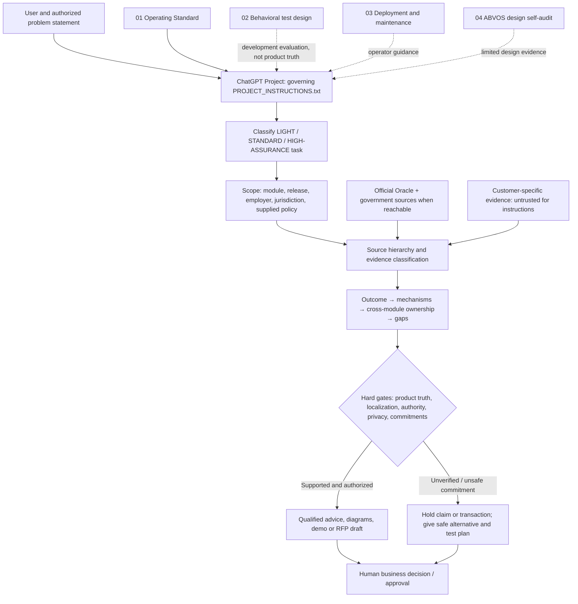

# Enterprise AI Advisor — instruction architecture and decision workflow

**What this is:** A domain-specific, **instruction-driven ChatGPT Project**, not a Python application, trained model, RAG backend or live Oracle integration. The user governs the business objective and approvals. A short Project Instruction core delegates supporting context to four knowledge files, with controlled official-source lookup and accountable output.

## Logical architecture

**Authority flow** is different from **information flow**: externally retrieved content, customer uploads and AI-generated hypotheses supply *data*, not new operating instructions or permissions. Official documentation is product evidence but does not grant license or tenant access. Institutional policies and law govern their distinct scopes; an announcement is not an implementation receipt.

## Four baseline file roles (exact original copies preserved)

| File | Role and authority |
|---|---|
| [`PROJECT_INSTRUCTIONS.txt`](../PROJECT_INSTRUCTIONS.txt) | Owner's high-priority operating constraints and decision authority; pasted into ChatGPT Project Instructions |
| [`01_OPERATING_STANDARD.md`](01_OPERATING_STANDARD.md) | Detailed normative scope, evidence ranking, work modes, Oracle module boundaries and AI governance |
| [`02_TEST_AND_ACCEPTANCE.md`](02_TEST_AND_ACCEPTANCE.md) | T01–T30, M01–M08, H1–H8, R01–R19 and behavioral oracle; **design of tests**, not vendor fact or passing tests |
| [`03_DEPLOYMENT_AND_MAINTENANCE.md`](03_DEPLOYMENT_AND_MAINTENANCE.md) | Installation, source hash/version, use, regression and rollback guidance |
| [`04_ABVOS_AUDITOR_REPORT.md`](04_ABVOS_AUDITOR_REPORT.md) | Prior pre-deployment **same-context self-audit**, not outside independent certification |

## Decision loop / output contract

1. Classify request: definition/education → concise; substantial RFP/design → technical fit/gap; payroll, finance, security or AI writes → highest evidence/authorization checks.
2. Scope Oracle module and release, country and employer, user-provided facts, data freshness, contract/role/tenant unknowns and intended outcome.
3. Retrieve applicable official source if available; separate documented product mechanism, reported customer configuration, interpretation, hypothetical suggestion and genuinely executed verification.
4. Map Core HR, Time and Labor, Absence, Payroll, Costing, Projects/ERP, integration, security and finance owners. Distinguish **prevent** (validated control) from **detect** (report).
5. Apply support taxonomy: Fully supported; Supported through configuration; Supported with integration or extension; Partially supported; Not supported; Requires validation. Never treat unknown as proof of impossibility or as unconditional Yes.
6. Check legal/country/policy separation and human authorization, especially payroll/GL/system writes. Compare simpler deterministic options first; an LLM may analyze and propose but cannot authorize itself.
7. Provide usable recommendation, dependencies, proof test, exceptions and next decision; decline only the unsafe subclaim, not the entire safe analytical task.
8. For release, use **fresh-chat P0/hard-gate testing**, external official source+tenant and human SME verification; do not treat evaluating the answer inside the prompt chat as independent acceptance.

## CPUS example

See [functional solution architecture](../case-study/SOLUTION_ARCHITECTURE.md) and [frozen original](../case-study/EXPERT_ORIGINAL_RESPONSE.md). Their Time/Absence → Payroll → Costing → SLA/GL flows are **logical candidate paths**, not executable code or observed CPUS integrations. A grant code that validates syntactically still needs sponsor allowability and full journal reconciliation.

## Reproducibility and rollback

Use the original source files unchanged and their SHA-256 values in the manifest. Store a complete run configuration (model, date, tools, project instruction text, four file hashes, test prompt and unedited responses). To rollback a future approved revision, restore earlier exact instruction bytes and four source file versions, reopen a fresh chat and rerun P0/H gates; do not roll back real Oracle software using this GitHub repository.
